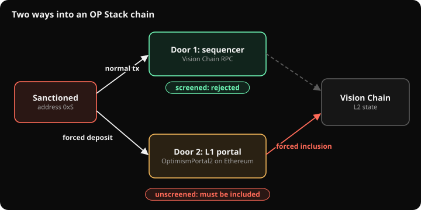
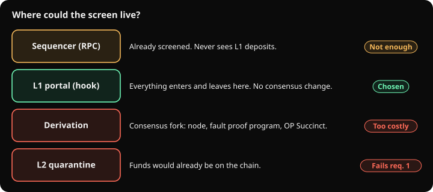
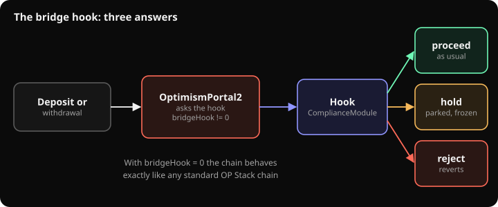
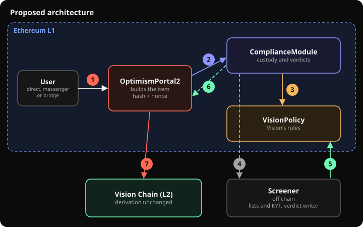
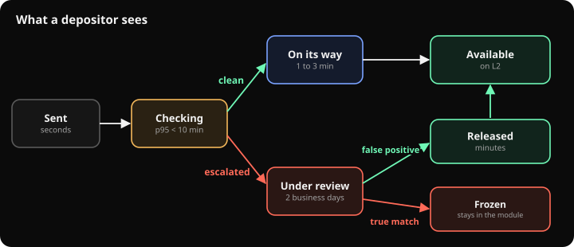
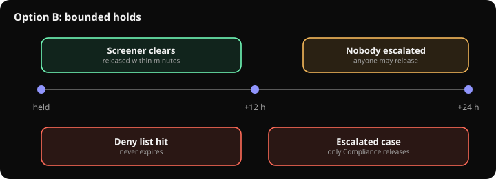

# Sanctions screening at the Vision Chain bridge

[](https://github.com/gotoalberto/vision-chain-bridge-screening/actions/workflows/scenarios.yml)

A working prototype of how an OP Stack chain can screen what comes in and out through its L1 bridge, freeze flagged funds instead of returning them, and let Compliance release false positives. It runs twelve scenarios against the real OP Stack L1 contracts, using the bridge hook, `ComplianceModule` and `VisionPolicyV1` that Optimism is building in the open.

Vision Chain is the Ethereum L2 that Bitpanda announced in March 2026, built on the OP Stack under OP Enterprise. Everything here comes from public sources.

## The problem

Vision Chain already screens transactions at the sequencer. That covers only what users send to the sequencer.

Every OP Stack chain has a second way in. Anyone can call `depositTransaction` on `OptimismPortal2` on Ethereum, and the chain must include that deposit on L2. The sequencer can delay it by at most the sequencing window (3,600 L1 blocks, about 12 hours), but it cannot drop it, because deposits are derived from L1 by every node. This is forced inclusion, the guarantee that keeps users safe from a censoring or offline sequencer.

<p align="center"></p>

A sanctioned address can use that second door to:

* bring new ETH or tokens onto the chain;
* move funds it already holds on L2 with a zero-value forced call (from an EOA the L2 sender is the same address), for example a transfer, a swap or a withdrawal.

What Compliance asked for:

1. Sanctioned or flagged addresses must not get transactions or funds onto the chain through the bridge without being screened.
2. Funds from a flagged address are frozen. They are not let through and not simply sent back.
3. If someone was flagged by mistake, Compliance can release the funds.

On top of those I added my own requirements, each with its assumption. These are the ones that shape the code.

* Zero-value forced calls are screened too, and both the real sender and the real recipient are checked.
* There is no function that refunds or redirects held funds. Returning funds to a listed person is making funds available to them (EU Regulation 269/2014, Art. 2(2)).
* Release takes two keys: Compliance clears the flag, the screener records the verdict, and then anyone can complete the item to its original destination.
* Only official list addresses go on chain. Risk alerts are handled without a public label.
* An allowlist for Bitpanda, banks and issuers that passed KYB, so they never wait.
* If the screener is down, holds stay in place and the deny list keeps working. The `disable` switch needs Compliance and Security together.

## Where the screen has to live

<p align="center"></p>

The portal on L1 is the only place that every deposit and every withdrawal passes through without touching consensus. Filtering in derivation would mean changing op-node, kona, the fault proof prestate and the OP Succinct SP1 program in exactly the same way, and keeping that fork alive on every hardfork. A quarantine contract on L2 is too late: the funds would already be on the chain.

## The design

Optimism has been building this upstream since October 2026. I use that work instead of forking the portal, and put Vision's decisions in a policy contract.

<p align="center"></p>

`OptimismPortal2` stores an optional `bridgeHook`. When it is set, the portal asks the hook about every deposit and every withdrawal finalisation. A held deposit emits no `TransactionDeposited`, so L2 derivation never sees it. When it is completed later it is emitted as an ordinary deposit. Nodes, derivation and proofs do not change.

<p align="center"></p>

1. The user deposits on L1, directly, through the messenger or through the standard bridge.
2. The portal builds the item (sender, target, values, data and a nonce) and asks the `ComplianceModule`.
3. The module resolves the real parties inside the messenger and bridge envelopes and asks `VisionPolicy`.
4. If the item is held, ETH moves to the module and ERC20s move out of the bridge escrow into the module. The module emits `Held`.
5. The screener reads the event, checks both parties with the vendor and, if clean, calls `clearAndCompleteDeposit`. Vision pays that gas, about 153k.
6. The module hands the value back and the portal checks the item is exactly the committed one.
7. The portal emits `TransactionDeposited` and the deposit arrives on L2.

What the design guarantees, and anyone can check on L1:

* Nobody, Bitpanda included, can redirect held funds. They can only reach the destination the user chose, short of a module upgrade behind a timelock.
* Every hold and every release is recorded on Ethereum.
* Anyone who is not on a list or in an open case gets their deposit in minutes.

### What users see

<p align="center"></p>

A flagged user sees "under review" for as long as it lasts, with no reason given. AML rules forbid telling a customer about an investigation, so formal communication goes through Compliance.

### Option B: bounded holds

<p align="center"></p>

With `VisionPolicyV1`, a screener outage leaves Compliance two choices: hold everyone indefinitely or flip `disable`, which also lets deny list addresses through. `BoundedHoldPolicy` adds a middle path on the same module and the same portal. A hold nobody has escalated can be released by anyone after 24 hours. Deny list hits and escalated cases never expire, so every indefinite freeze is a recorded human decision. The risk is that an unreviewed deposit passes after a 24 hour outage. That call belongs to Compliance.

### Where the code lives

The hook itself is Optimism's code. This repository adds the scenarios and the alternative policy, and pins everything to the head of PR #24033 (`403dce99d2`).

| What | File |
|---|---|
| Portal asks the hook on deposits, holds and commits the item | [`OptimismPortal2.sol` L928 to L950](https://github.com/ethereum-optimism/optimism/blob/403dce99d2ad2d95ca929f6e77472f8f5a3fb26b/packages/contracts-bedrock/src/L1/OptimismPortal2.sol#L928-L950) |
| Portal asks the hook when a withdrawal is finalised | [`OptimismPortal2.sol` L724 to L752](https://github.com/ethereum-optimism/optimism/blob/403dce99d2ad2d95ca929f6e77472f8f5a3fb26b/packages/contracts-bedrock/src/L1/OptimismPortal2.sol#L724-L752) |
| Completing a held item, only the exact committed one | [`OptimismPortal2.sol` L979 to L1000](https://github.com/ethereum-optimism/optimism/blob/403dce99d2ad2d95ca929f6e77472f8f5a3fb26b/packages/contracts-bedrock/src/L1/OptimismPortal2.sol#L979-L1000) |
| ERC20 escrow moved to the module and back | [`L1StandardBridge.sol` `holdERC20` and `restoreERC20`](https://github.com/ethereum-optimism/optimism/blob/403dce99d2ad2d95ca929f6e77472f8f5a3fb26b/packages/contracts-bedrock/src/L1/L1StandardBridge.sol#L298-L340) |
| Hook interface | [`IBridgeHook.sol`](https://github.com/ethereum-optimism/optimism/blob/403dce99d2ad2d95ca929f6e77472f8f5a3fb26b/packages/contracts-bedrock/interfaces/L1/IBridgeHook.sol) |
| The hook: custody, verdicts, `disable` | [`ComplianceModule.sol`](https://github.com/ethereum-optimism/optimism/blob/403dce99d2ad2d95ca929f6e77472f8f5a3fb26b/packages/contracts-bedrock/src/compliance/ComplianceModule.sol) |
| Vision's reference policy | [`VisionPolicyV1.sol`](https://github.com/ethereum-optimism/optimism/blob/403dce99d2ad2d95ca929f6e77472f8f5a3fb26b/packages/contracts-bedrock/src/compliance/VisionPolicyV1.sol) |
| Option B policy | [`test/vision/BoundedHoldPolicy.sol`](test/vision/BoundedHoldPolicy.sol) |
| Scenarios | [`test/vision/VisionBridgeScenarios.t.sol`](test/vision/VisionBridgeScenarios.t.sol), [`test/vision/BoundedHoldScenarios.t.sol`](test/vision/BoundedHoldScenarios.t.sol) |

## Scenarios

| # | Scenario | Result |
|---|---|---|
| 1 | Allowlisted bank deposits 10 ETH | Passes with no wait |
| 2 | Unknown clean user deposits 1 ETH | Held, cleared by the screener, arrives on the same terms |
| 3 | Sanctioned address deposits 5 ETH | Frozen in the module. Neither the screener nor a third party can release it. No refund path exists |
| 3b | Sanctioned address forces a zero-value L2 call | Held as well |
| 3c | Bank deposits to a sanctioned L2 recipient | Held. The deny list beats the allowlist |
| 4 | False positive | Compliance clears, screener releases, anyone completes. Changing the recipient fails |
| 5 | Sanctioned address bridges 100 tokens | Tokens leave the bridge escrow and sit in the module |
| 6 | ProxyAdmin owner deposits an L2 upgrade | Not screened, as the spec says, so governance can always reach L2 |
| 7 | Screener outage and `disable` | New items pass, held items stay held |
| B1 | Option B, screener down for 24 hours | Anyone releases the hold when the clock runs out |
| B2 | Option B, deny list address | Still frozen a year later |
| B3 | Option B, escalated case | Only leaves when Compliance closes it |

Each scenario logs what the user would see. Full output: [docs/sample-output.txt](docs/sample-output.txt).

Gas measured in the scenarios: about 195k for a normal deposit, 181k for a held one and 153k to clear and complete it.

## Run it

You need git and [Foundry](https://getfoundry.sh) 1.8 or newer.

```bash
./run.sh
```

The script does a sparse clone of `ethereum-optimism/optimism` at the head of PR #24033, copies the scenarios into `packages/contracts-bedrock/test/vision` and runs them with the `BRIDGE_HOOK` dev feature on. It takes about a minute. To reuse an existing checkout, pass its path: `./run.sh ../optimism`.

The same script runs in GitHub Actions on every push.

## Trade-offs

* **Not Stage 1.** A policy can hold exits, and Optimism's own spec says a chain with a hook is not a Stage 1 rollup. Going by Robinhood Chain, ETHBEAT (formerly L2BEAT) would rate Sequencer failure as "No mechanism". Better to say it first and publish the policy.
* **Not a standard chain.** The StandardValidator flags any hook as `PORTAL-110`. Maintenance stays cheap, because OPCM keeps the hook across upgrades and the custom part is one policy contract. The cost is in positioning. A forked portal would also mean a rebase and an audit on every release, and the portal has changed in every release since 2025.
* **No interop, no custom gas token.** OPCM rejects a hook on chains with either. Vision's MiCA white paper says gas is ETH.
* **Custody.** Whoever can upgrade the module controls everything held, so the module sits behind a multisig with a timelock. Removing the hook strands held items in the old module.
* **Out of scope.** Third-party bridges (CCTP, LayerZero) and the NFT bridge do not go through this path. The sequencer screen and partner contracts cover them.

## Limits of this prototype

* It uses Optimism code from open, unaudited pull requests. Do not deploy it.
* It exercises L1. It does not start an L2 node, which is not needed because derivation is unchanged: a `TransactionDeposited` always reaches L2.
* Screened withdrawals are not in the scenarios, since they need a resolved dispute game. Optimism's own tests cover them.
* `BoundedHoldPolicy` simplifies withdrawal handling.

## Built on

* Bridge hook in `OptimismPortal2`: optimism PRs [#23415](https://github.com/ethereum-optimism/optimism/pull/23415), [#23520](https://github.com/ethereum-optimism/optimism/pull/23520), [#23736](https://github.com/ethereum-optimism/optimism/pull/23736), [#23771](https://github.com/ethereum-optimism/optimism/pull/23771), [#23891](https://github.com/ethereum-optimism/optimism/pull/23891)
* `ComplianceModule` and `VisionPolicyV1`: PRs [#24025](https://github.com/ethereum-optimism/optimism/pull/24025) and [#24033](https://github.com/ethereum-optimism/optimism/pull/24033)
* Compliance Module spec: [specs #971](https://github.com/ethereum-optimism/specs/pull/971)
* Deposits and derivation: [specs.optimism.io](https://specs.optimism.io/protocol/deposits.html)

## License

MIT
